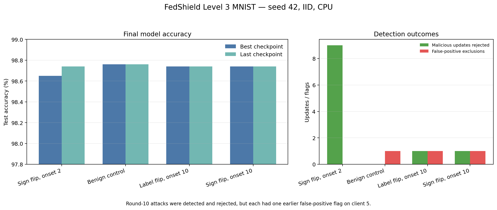

# FedShield Level 3: First Integrated Run Report

**Run set:** MNIST, seed 42, IID client split, 10 clients, 10 rounds, one local epoch per client per round  
**Environment:** CPU, PyTorch 2.15.0  
**Report scope:** first integrated Level 3 runs; results are descriptive and do not establish performance across seeds or hardware.

## Summary

The Level 3 pipeline completed end to end: client updates were trained, scored, filtered, aggregated, and evaluated. Best and last checkpoints were written and successfully reloaded for the benign, late-onset label-flip, and late-onset sign-flip runs. The synthetic detector checks also passed.

The onset-2 sign-flip run detected client 3 in all nine attack rounds, rejected all nine malicious updates, and made no false-positive exclusions. The later-onset runs detected the attacker in its single attack round, but each also falsely flagged client 5 once in round 2. The benign run had the same one false-positive flag. Because the final client verdict requires repeated evidence, neither late-onset attack run produced a final malicious-client verdict.



## Experiment setup

- Dataset: MNIST with the project’s held-out 500-example server validation split.
- Client partition: IID, 10 clients, seed 42.
- Training: 10 rounds, one local epoch per client per round, learning rate 0.01, momentum 0.9.
- Detector: validation evidence enabled, threshold 8.0; at most one scored client flagged per round.
- Attacker: client 3 for attack runs; client IDs are zero-based and rounds are one-based.
- Device and software: CPU, PyTorch 2.15.0. No CUDA device was available in this environment.

## Results

| Scenario | Best test accuracy | Last test accuracy | Malicious updates rejected | False-positive exclusions | Detection result |
| --- | ---: | ---: | ---: | ---: | --- |
| Sign flip, onset round 2 | 98.65% | 98.74% | 9/9 | 0 | Client 3 first flagged in round 2; final verdict was client 3. |
| Benign control | 98.76% | 98.76% | — | 1 | Client 5 flagged once in round 2; no malicious-client verdict. |
| Label flip, onset round 10 | 98.74% | 98.74% | 1/1 | 1 | Client 3 flagged in round 10 (zero-round delay); client 5 had an earlier false positive; no final verdict. |
| Sign flip, onset round 10 | 98.74% | 98.74% | 1/1 | 1 | Client 3 flagged in round 10 (zero-round delay); client 5 had an earlier false positive; no final verdict. |

“False-positive exclusions” count benign client updates excluded by the detector. The round-10 attacks were caught during the attack round, but the early false-positive exclusion shows why the single-round flag and the repeated-evidence client verdict should be reported separately.

## Checkpoint and detector checks

- The benign, label-flip, and late-onset sign-flip best/last checkpoint pairs reloaded successfully with `--eval-only` and reproduced the test accuracies shown above.
- The default onset-2 sign-flip run completed and reported its best and last test accuracies at the end of training.
- Synthetic checks passed for the supported synthetic attack scenarios, late-onset exclusion, benign false-positive behavior in that synthetic setup, invalid updates, validation evidence, threshold calibration, and split leakage.
- Synthetic benign behavior differs from the integrated MNIST benign run: the synthetic check recorded no false positives, while the integrated benign run recorded one flag. Report the integrated observation alongside the synthetic result.

## Interpretation and limits

This first run shows that the detector can exclude the tested sign-flip and label-flip client updates, including an attack that begins in the final round. However, one early false-positive flag occurred in the benign control and both late-onset attack runs. The conservative final verdict avoids calling the attacker from one flag, but it also returns no verdict for an attacker observed only once. These outcomes should be treated as an initial observation, not a general accuracy or robustness claim.

The run used PyTorch 2.15.0 on CPU, so it does not verify execution on the target GPU with PyTorch 2.7.0. Additional seeds, attack identities, and target-environment runs are needed before drawing broader conclusions.

## Reproduction

From `fedshield/`, run:

```bash
python3 test_detector_synthetic.py
python3 level3_fedshield.py --attack sign_flip --onset 2 --malicious-id 3 --device auto
python3 level3_fedshield.py --attack none --device auto \
  --best-ckpt checkpoints/fedshield_benign_best.pt \
  --last-ckpt checkpoints/fedshield_benign_last.pt \
  --log-path logs/fedshield_benign_iid_seed42.jsonl
python3 level3_fedshield.py --attack label_flip --onset 10 --malicious-id 3 --device auto \
  --best-ckpt checkpoints/fedshield_label_flip_best.pt \
  --last-ckpt checkpoints/fedshield_label_flip_last.pt \
  --log-path logs/fedshield_label_flip_iid_seed42_onset10.jsonl
python3 level3_fedshield.py --attack sign_flip --onset 10 --malicious-id 3 --device auto \
  --best-ckpt checkpoints/fedshield_late_sign_flip_best.pt \
  --last-ckpt checkpoints/fedshield_late_sign_flip_last.pt \
  --log-path logs/fedshield_sign_flip_iid_seed42_onset10.jsonl
python3 plot_results.py
```

The JSON result summaries and detector logs are in `logs/`; compact plotted metrics are in [`results/level3_cpu_runs.json`](results/level3_cpu_runs.json). For model reload checks, use `--eval-only` with the matching `--best-ckpt` and `--last-ckpt` paths.
