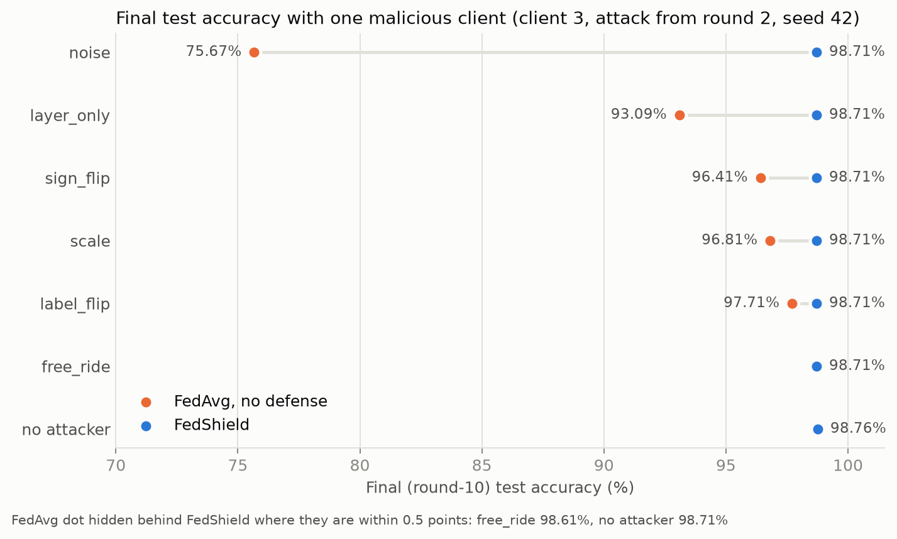
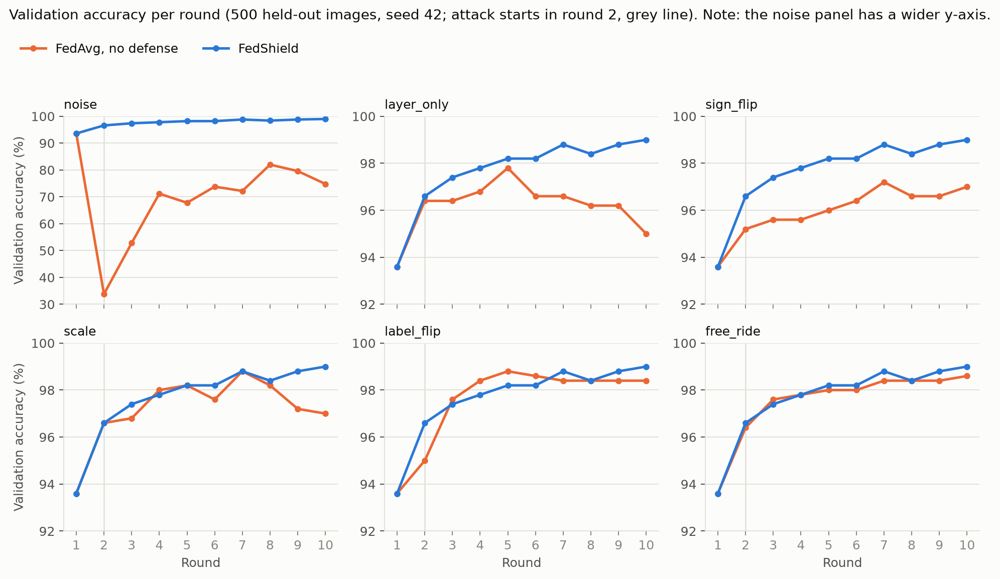

# FedShield Level 3 results

**Setup:** MNIST, 10 clients, IID split, 10 rounds, 1 local epoch per round, client 3 malicious (zero-indexed) unless stated otherwise, detector threshold 14.0 (calibrated on benign development seeds 101–105, see [`results/calibration/`](results/calibration/README.md)).
**Environment:** GTX 1080 Ti, PyTorch 2.7.0, Nov 24, 2026. About 2 minutes per run.
**Source:** 62 runs from `python run_sweep.py` (blocks A–G). Per-run numbers are in [`results/level3_runs.json`](results/level3_runs.json), and the full per-round logs are in `logs/fedshield_*`. All accuracies are on the MNIST test set, using the round-10 model, which is the model the course evaluates.

## 1. Defense on vs off

Seed 42, attack starts in round 2 (9 attack rounds).



| Attack | FedAvg, no defense | FedShield | Malicious uploads rejected | Detection delay | Honest uploads rejected | Final verdict |
| --- | ---: | ---: | ---: | ---: | ---: | --- |
| `noise` | 75.67% | 98.71% | 9/9 | 0 rounds | 0 | client 3 |
| `layer_only` | 93.09% | 98.71% | 9/9 | 0 rounds | 0 | client 3 |
| `sign_flip` | 96.41% | 98.71% | 9/9 | 0 rounds | 0 | client 3 |
| `scale` | 96.81% | 98.71% | 9/9 | 0 rounds | 0 | client 3 |
| `label_flip` | 97.71% | 98.71% | 9/9 | 0 rounds | 0 | client 3 |
| `free_ride` | 98.61% | 98.71% | 9/9 | 0 rounds | 0 | client 3 |
| no attacker | 98.71% | 98.76% | — | — | 0 | none |

- Without a defense, one malicious client out of ten costs between 0.1 points (`free_ride`) and 23 points (`noise`). The `noise` attack drops validation accuracy to 34% in round 2, the first attack round.
- With FedShield, the attacker was excluded in every attack round, starting with the first, and no honest client was ever excluded.
- **Why every defended run ends at exactly 98.71%:** from round 2 on, client 3 is excluded every round. Each round then averages the same 9 honest updates, whatever client 3 uploaded. Round 1 is identical too, because the attacker trains honestly before the onset. The model is therefore the same in all six runs. The no-attacker run averages all 10 clients, so it differs slightly (98.76%).
- `free_ride` barely hurts plain FedAvg. An unchanged model only dilutes the average by 1/10. It is still worth catching, because the client gets the global model without contributing.



Undefended, `layer_only` and `scale` lose accuracy in the later rounds; for both, the round-10 model is worse than the round-5 model. Under FedShield, all six curves are identical and rise steadily.

## 2. Late attacks

Seed 42, FedShield.

| Attack | Onset | Attack rounds | Rejected | Honest uploads rejected | Final verdict | Final test acc |
| --- | ---: | ---: | ---: | ---: | --- | ---: |
| `sign_flip` | 5 | 6 | 6/6 | 0 | client 3 | 98.70% |
| `label_flip` | 5 | 6 | 6/6 | 0 | client 3 | 98.70% |
| `sign_flip` | 10 | 1 | 1/1 | 0 | client 3 | 98.75% |
| `label_flip` | 10 | 1 | 1/1 | 0 | client 3 | 98.75% |

An attack that appears only in round 10 is still excluded in that round and named in the final verdict. One flag counts as strong evidence when its score is at least 2 × the threshold.

## 3. Ablations

Seed 42, onset 2, each run removes one defense component.

| Condition | `layer_only` | `label_flip` |
| --- | ---: | ---: |
| Full FedShield | 98.71%, 9/9 rejected | 98.71%, 9/9 rejected |
| No validation evidence (`--no-validation`) | 98.71%, 9/9 rejected | 98.71%, 9/9 rejected |
| No norm clipping (`--no-clip`) | 98.72%, 9/9 rejected | 98.72%, 9/9 rejected |

Removing either component changes nothing in these runs. The layer-aware norm and cosine scores alone exclude every attacker upload, even for `layer_only` (the weakest attack in calibration, minimum score 45.6 against a threshold of 14). The clipping bound of 5.0 is far larger than honest updates, so clipping almost never changes them. The 0.01-point difference without clipping is within noise. These attacks are too obvious to show what validation evidence or clipping add; section 6 tests weaker attacks for that.

## 4. Seed spread

FedShield, onset 2, seeds 42, 7, and 123.

| Attack | Seed 42 | Seed 7 | Seed 123 | Mean ± std | Rejected (all seeds) | Honest uploads rejected |
| --- | ---: | ---: | ---: | ---: | ---: | ---: |
| each of the 6 attacks | 98.71% | 98.77% | 98.62% | 98.70% ± 0.08 | 27/27 per attack | 0 |
| no attacker | 98.76% | 98.72% | 98.65% | 98.71% ± 0.06 | — | 0 |

Each attack's row is identical, for the reason given in section 1. Across all of these runs, every attacker upload was rejected in the round it was sent, and no honest upload was ever rejected.

## 5. Random malicious client

Sections 1–4 always use client 3, so that the defense on/off comparison changes only the attack. To check that detection does not depend on which client attacks, the same 6 attacks were rerun with `--malicious-id random`. The attacker is drawn from the seed with a separate random generator, so training is not affected. Seed 42 picked client 9; seeds 7 and 123 picked client 7. FedShield, onset 2:

| Seed | Malicious client | Final test acc (each of the 6 attacks) | Rejected | Honest uploads rejected | Final verdict |
| --- | ---: | ---: | ---: | ---: | --- |
| 42 | 9 | 98.69% | 9/9 per attack | 0 | client 9 (6/6 runs) |
| 7 | 7 | 98.68% | 9/9 per attack | 0 | client 7 (6/6 runs) |
| 123 | 7 | 98.71% | 9/9 per attack | 0 | client 7 (6/6 runs) |
| **Mean ± std** | | **98.69% ± 0.02** | | | |

The results match the client-3 runs: every attacker upload was rejected from the first attack round, no honest client was excluded, and every verdict named the right client. Accuracy differs slightly from section 4 because a different honest client is left out of each round. The detector never sees `--malicious-id`; it is used only to pick which client attacks and to score the result afterwards. Logs end in `_mal9` / `_mal7`.

## 6. Weak attacks: what validation and clipping add

Section 3 showed no difference from removing validation or clipping, because every attack scored far above the threshold. To test those parts, weaker versions of three attacks were run (`--attack-setting`). The strengths were chosen on development seed 101 with nothing excluded, the same way as the threshold (logs: [`results/weak_attack_probe/`](results/weak_attack_probe/)), and then evaluated on seed 42.

Probe on seed 101 (attacker score in rounds 2–10; threshold 14, highest honest score 5.8):

| Weak attack | Layer-aware score | Added by validation | Outcome |
| --- | ---: | ---: | --- |
| `scale` ×3 (normal ×10) | 9.9–10.5 | +32 to +61 | caught only with validation |
| `sign_flip` ×−1 (normal ×−5) | 21–30 | +0.2 to +3 | caught by layer scores alone |
| `noise` std 0.01 (normal 1.0) | 15–16 | 0 | caught by layer scores alone |
| `layer_only` ×−1 (normal ×−10) | 7.8–13.1 | 0 to +0.7 | mostly missed |
| `noise` std 0.002 | 9.7–12.9 | 0 | missed |
| `scale` ×1.5 | 3.7–3.9 | +2 to +5 | missed |

Evaluation on seed 42 (client 3, onset 2):

| Weak attack | Condition | Rejected | Final test acc | Final verdict |
| --- | --- | ---: | ---: | --- |
| `scale` ×3 | Full FedShield | 9/9 | 98.71% | client 3 |
| `scale` ×3 | No validation evidence | **0/9** | 98.72% | none |
| `scale` ×3 | No clipping | 9/9 | 98.72% | client 3 |
| `scale` ×3 | FedAvg, no defense | — | 98.72% | — |
| `layer_only` ×−1 | Full FedShield | 4/9 | 98.71% | client 3 |
| `layer_only` ×−1 | FedAvg, no defense | — | 98.70% | — |
| `sign_flip` ×−1 | Full FedShield | 9/9 | 98.71% | client 3 |
| `sign_flip` ×−1 | FedAvg, no defense | — | 98.53% | — |

No honest upload was rejected in any of these runs.

- **Validation evidence catches what the layer scores miss.** With validation, `scale` ×3 was rejected in all 9 rounds. Without it, the layer score alone (10.8–12.4) stayed under the threshold and the attacker was accepted every round. Applying the ×3 update raises the server's validation loss sharply, which adds +25 to +122 to the score.
- **But the attacks that slip past a component barely hurt accuracy.** Undefended, `scale` ×3 ends at 98.72% and `layer_only` ×−1 at 98.70%, both the same as the defended model. After averaging with 9 honest clients, their effect disappears. Only `sign_flip` ×−1 costs accuracy (−0.18 points), and the layer scores catch it every round. In our tests, attacks subtle enough to evade part of FedShield were also too weak to damage the model.
- **Clipping still shows no measurable benefit.** No tested attack is both accepted and harmful, so there is nothing for clipping to limit.

## Limitations

- **Narrow conditions:** all runs use an IID split, a single malicious client, and 3 evaluation seeds. The threshold was calibrated on IID benign runs. A non-IID split (`--partition dirichlet`) makes honest updates less alike and was not evaluated.
- **Narrow attacker coverage:** the malicious client was client 3, 9, or 7 (section 5); other IDs were not tested.
- **No adaptive attacks:** section 6's weak attacks were fixed in advance. An attacker that adjusts its update to stay just under the threshold while still doing harm was not tested, and clipping's benefit is not demonstrated. An attack scoring between 14 and 28 that appears only in round 10 would be excluded but not named in the verdict.
- **Small validation set:** per-round validation accuracy comes from 500 held-out images, so steps of 0.2 points are single images.

## Reproduce

From `fedshield/`:

```bash
python run_sweep.py            # all 62 runs, skips any already logged with the current threshold (~2 h on GPU)
python run_sweep.py --block G  # only one block (A-G, see the top of run_sweep.py)
python run_sweep.py --summary  # rebuild results/level3_runs.json from the logs
python plot_results.py         # redraw plots/fedshield_results.png and plots/fedshield_rounds.png
```
